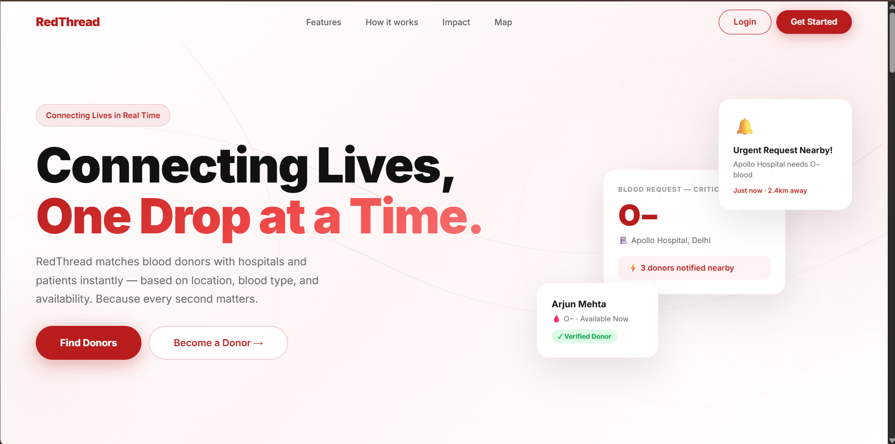
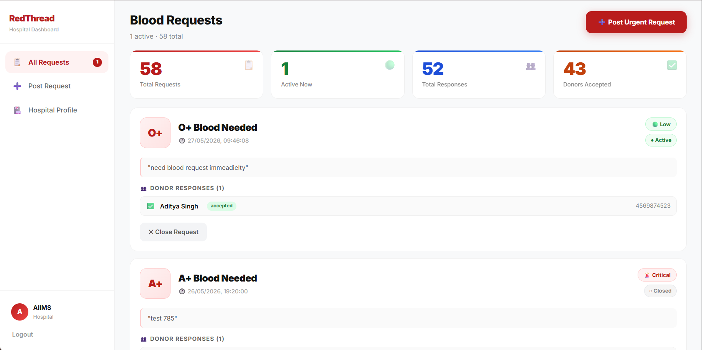
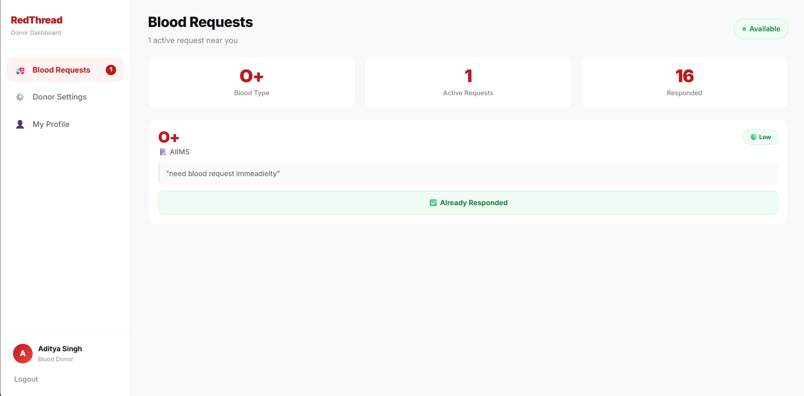

# RedThread

A full-stack blood donor finder that matches hospitals with nearby donors in real time. Hospitals post urgent blood requests, and available donors of the matching blood type within 10 km are notified by email and can accept or decline from their dashboard.


## Features

*   Role-based donor and hospital dashboards
*   Server-side geolocation matching using the Haversine formula (10 km radius)
*   Automated email alerts to donors and hospitals via the Brevo API
*   Email/password and Google OAuth login through Supabase Auth
*   Request lifecycle with an audit trail (active, accepted, rejected, closed)
*   Dashboard auto-refresh every 10 seconds

## Project Structure

*   `frontend/`: React frontend (Vite + Tailwind CSS)
    *   `public/`: `favicon.svg`, `icons.svg`
    *   `src/assets/`: `hero.png`, `react.svg`, `vite.svg`
    *   `src/components/`: `AuthLoader.jsx`, `ProtectedRoute.jsx` (Token and role guard)
    *   `src/config/`: `supabase.js`
    *   `src/pages/`: `AuthCallback.jsx`, `CompleteProfile.jsx`, `DonorDashboard.jsx`, `HospitalDashboard.jsx`, `Landing.jsx`, `Login.jsx`, `Register.jsx`
    *   `vercel.json`: Vercel deployment configuration
*   `backend/`: Node.js + Express backend
    *   `config/`: Backend configuration setup
    *   `middleware/`: JWT validation through Supabase
    *   `routes/`: API endpoints (`auth.js`, `donor.js`, `hospital.js`)
    *   `utils/`: Haversine distance function and Brevo email helper
    *   `index.js`: Main server entry point
*   `.env`: Private environment variables

## Tech Stack

*   Frontend: React.js, Vite, Tailwind CSS
*   Backend: Node.js, Express.js
*   Database and Auth: Supabase (PostgreSQL, JWT, Google OAuth)
*   Email: Brevo transactional API (via Axios)
*   Matching Algorithm: Haversine formula
*   Deployment: Vercel (frontend), Render (backend)

## Database Schema

*   `profiles`: id, role, name, phone, email
*   `donors`: id, blood_type, is_available, latitude, longitude
*   `requests`: id, hospital_id, blood_type, urgency_level, message, latitude, longitude, is_active
*   `responses`: id, request_id, donor_id, status

## Prerequisites

*   Node.js 18+
*   A [Supabase](https://supabase.com/) project
*   A [Brevo](https://www.brevo.com/) account with an API key and a verified sender email
*   Google OAuth credentials configured in Supabase

## Setup and Installation

**1. Clone the repository:**
```bash
git clone YOUR_GITHUB_LINK
cd RedThread
```

**2. Install the dependencies:**
```bash
# Backend
cd backend
npm install

# Frontend
cd ../frontend
npm install
```

**3. Configure Environment Variables:**

Create `backend/.env`:
```env
SUPABASE_URL="your_supabase_url"
SUPABASE_ANON_KEY="your_supabase_anon_key"
BREVO_API_KEY="your_brevo_api_key"
BREVO_SENDER_EMAIL="your_verified_sender_email"
PORT=5000
```

Create `frontend/.env`:
```env
VITE_SUPABASE_URL="your_supabase_url"
VITE_SUPABASE_ANON_KEY="your_supabase_anon_key"
VITE_API_URL="http://localhost:5000"
```

**4. Run the application:**
```bash
# Start the backend
cd backend
node index.js

# Start the frontend (new terminal)
cd frontend
npm run dev
```

The frontend runs on `http://localhost:5173`.

## API Routes

| Endpoint | Method | Description |
| --- | --- | --- |
| `/auth/register` | POST | Register a user and create profile rows |
| `/auth/login` | POST | Log in and return a JWT session |
| `/auth/complete-profile` | POST | Create a profile after Google OAuth |
| `/donor/profile` | GET/PUT | View or update donor settings |
| `/donor/requests` | GET | Active requests matching the donor |
| `/donor/request/:id/accept` | POST | Accept a request and notify the hospital |
| `/donor/history` | GET | Donor response history |
| `/hospital/request` | POST | Post a request, run matching, send emails |
| `/hospital/requests` | GET | Active requests for the hospital |
| `/hospital/request/:id/close` | PUT | Close a request |
| `/hospital/history` | GET | All requests with nested responses |

## Deployment Notes

*   Add your Vercel URL to the `allowedOrigins` array in the backend CORS config.
*   For Google OAuth, set the same production URL in three places: `redirectTo` in the frontend, the Supabase Site URL, and the Google Cloud Console redirect URIs.
*   Use Brevo (HTTP API) instead of Gmail SMTP, which times out on cloud hosts.

## Images





## Future Enhancements

*   Supabase real-time subscriptions instead of polling
*   Push notifications (FCM)
*   Hospital verification workflow
*   Interactive map view

[Live Demo](https://red-thread-blood-and-organ-donar-fi.vercel.app/)